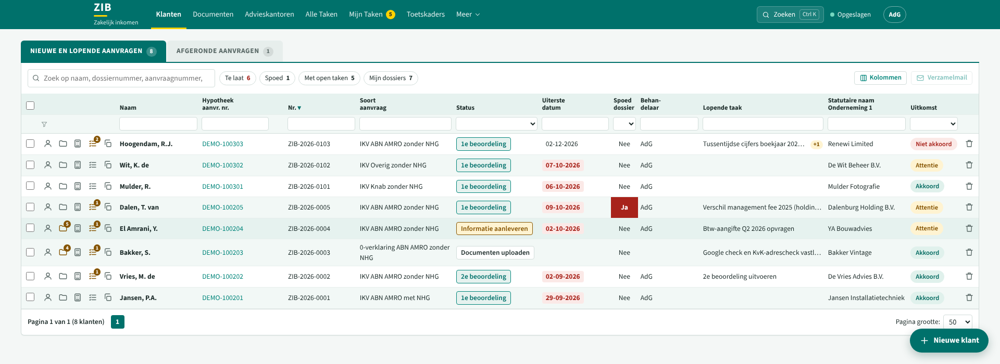
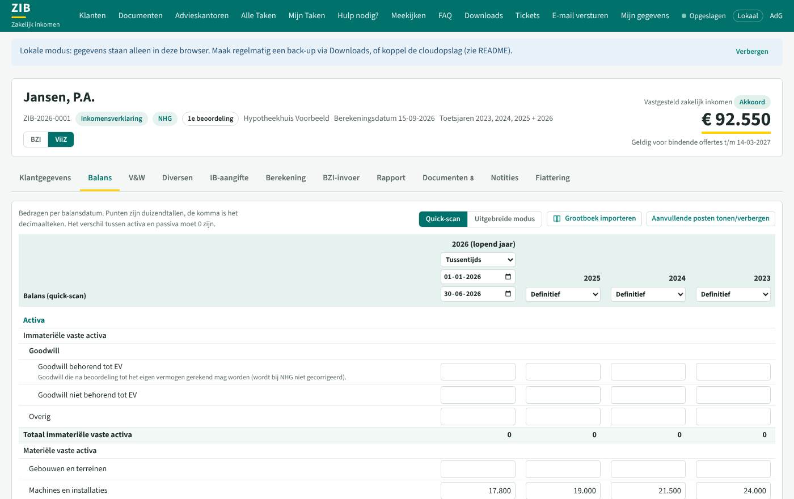
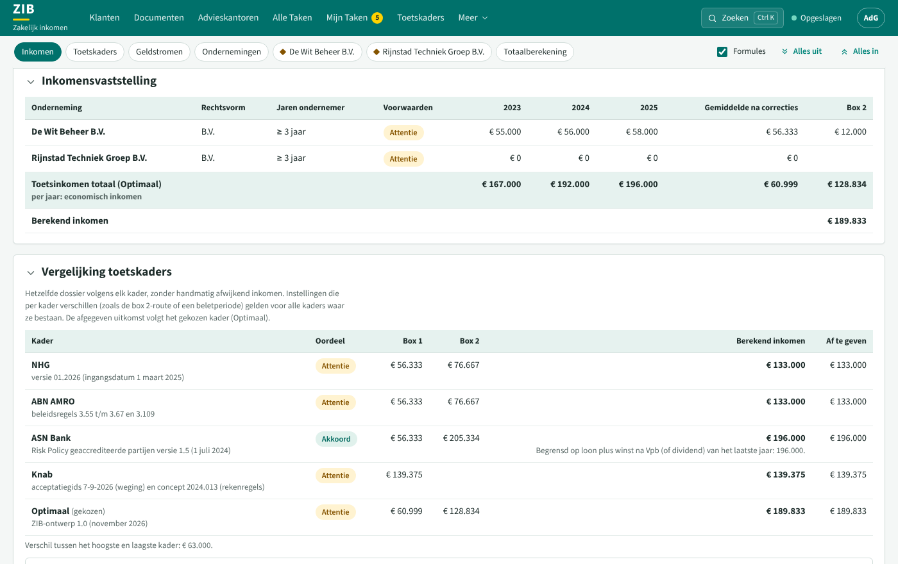
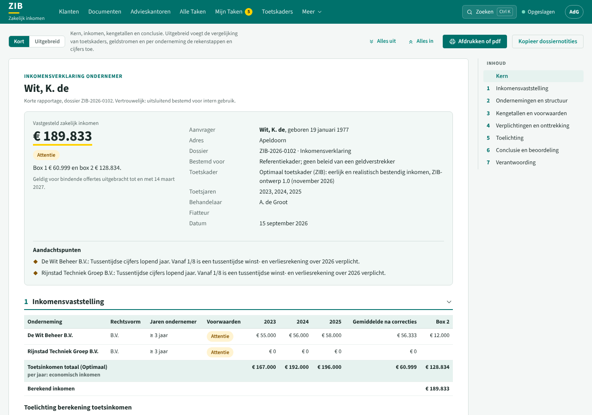
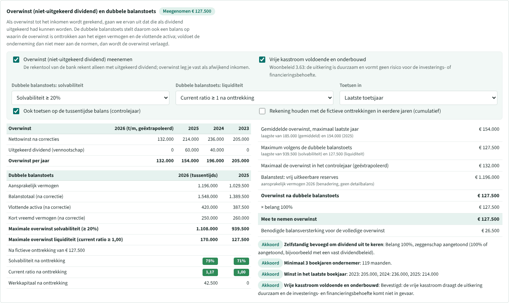
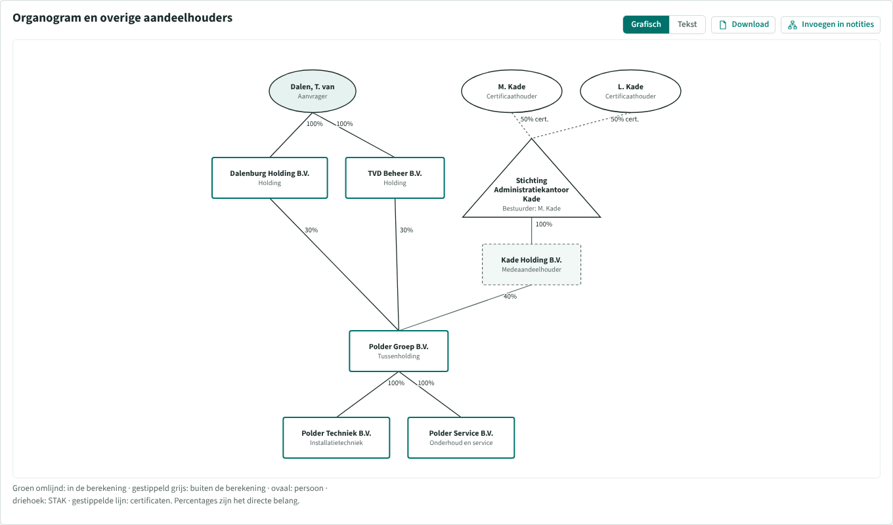
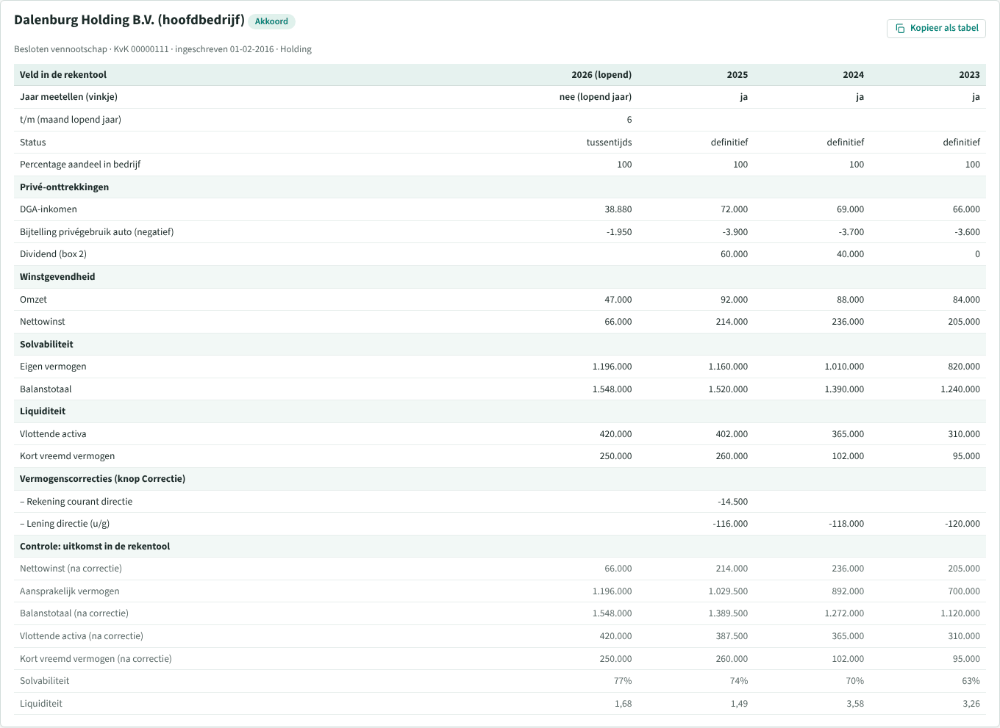

# ZIB: bepaling van bestendig zakelijk inkomen

ZIB is een webapplicatie voor acceptanten zakelijk inkomen. Je voert per klantdossier de jaarcijfers in, ZIB berekent het bestendig zakelijk inkomen, toetst de voorwaarden en maakt een herleidbare rapportage met alle rekenstappen. De opzet volgt de rekensoftware voor inkomensverklaringen (ViiZ): volledige balans en W&V, normalisaties, overwinst met dubbele balanstoets, rekenstappen met formules en een uitgebreid rapport. Voor ABN AMRO-dossiers vertaalt ZIB de uitkomst bovendien naar de invoer van de rekentool van de bank (BZI).

Vijf basiskaders en vijftien aanvullende geldverstrekkerprofielen. Kies bij Klantgegevens een geldverstrekker en klik op Opslaan. De beoordeling toont alleen dat kader; met NHG is dat alleen NHG. Kies Inkomensanalyse als je alle uitkomsten naast elkaar wilt zien:

| Kader | Inkomensverklaring (IKV) |
|---|---|
| **NHG** – Toetskaders Inkomensverklaring Ondernemer 01.2026 | Gemiddelde 3 jaar, max. laatste jaar; lopend jaar alleen verlagend; vervanging oudste jaar; bandbreedtemodel solvabiliteit; box 2 via route 1, route 2 (overwinst met dubbele balanstoets) of combinatie |
| **ABN AMRO** – Woonbeleid zakelijk inkomen | Berekend inkomen zoals de rekentool van de bank (per hoofdbedrijf, dividend max. nettowinst × belang) plus de toets aan het Woonbeleid: laagste van gemiddelde en laatste jaar, starters 75%/90%, dividendplafond, niet-uitgekeerd dividend met dubbele balanstoets, holdingroute |
| **ASN Bank** (voorheen de Volksbank) – Risk Policy v1.5 | Gemiddelde 3 jaar (verlies telt mee); DGA: loon + winst na Vpb + dividend bij > 50% met dubbele balanstoets (CR ≥ 1, solvabiliteit ≥ 20%), max. loon + winst laatste jaar; starters 75%/90% over werkelijke maanden; max. drie entiteiten |
| **Knab** – acceptatiegids 2026 en concept toetskader 2024.013 | 1-3-4-methode zonder NHG (acceptatiegids; 1-2-3 uit het concept instelbaar), max. 10% boven 1-1-1 en 20% boven NHG; starters 1-1-1 met 80%/90%; beletperiode; dividend per jaar in het totaal; risicosectoren |
| **Optimaal** – eigen referentiekader | Economisch inkomen (loon + aandeel in de winst na Vpb met zeggenschap, look-through met groepseliminatie, minderheidsdividend met trackrecord), 1-2-3-weging, lopend jaar naar rato, uitkeerbaarheid, afslag voor beweeglijkheid; parameters instelbaar |

**Aanvullende profielen:** Venn, ING, Rabobank, NIBC, Attens, Syntrus Achmea, Lloyds Bank, MUNT Hypotheken, Merius, Nationale-Nederlanden, a.s.r., bijBouwe Basis, Dynamic Verhuurhypotheek, bunq Easy Mortgage en Tulp Hypotheken. Afhankelijk van de route berekent ZIB een indicatie, gebruikt het de NHG-basis of registreert het een verplichte inkomensverklaring of bankbeoordeling. Zie [docs/GELDVERSTREKKERS.md](docs/GELDVERSTREKKERS.md) voor de bronnen en de grenzen van de berekeningen.

De 0-verklaring (nul-inkomen) beoordeelt verplichtingen, zekerheden, kasstroom en verlies → € 0 met eventuele maandlastcorrectie. De kaders van ABN AMRO, ASN Bank en Knab zijn in eigen woorden vertaald uit (interne) beleidsdocumenten: eigen interpretatie, geen officiële publicatie. Zie [docs/REKENREGELS.md](docs/REKENREGELS.md) en de pagina Toetskaders in de app.

> ZIB is een rekenhulpmiddel. De beoordeling, motivering en verantwoordelijkheid blijven bij de acceptant. Controleer bij twijfel altijd het actuele beleidskader.



| Balans (invoer: recent jaar links) | Berekening (overzicht: van oud naar nieuw) |
|---|---|
|  |  |

| Rapport met kern, hoofdstukken en inhoudsopgave | Overwinst en dubbele balanstoets |
|---|---|
|  |  |

| Organogram met STAK en medeaandeelhouder | BZI-invoer |
|---|---|
|  |  |

## Wat zit erin

- **Werkruimte en dossieroverzicht**: open op de aanvragen met een directe filter voor te late en bijna verlopen dossiers en open taken. Elk bestaand dossier opent met de aanbevolen volgende stap, een voortgangsoverzicht en links naar stukken, invoer, berekening en fiattering. De bestaande links naar individuele invoerpagina's blijven werken.
- **Rapport delen en controleren**: bovenaan staan de inkomensuitkomst, de geregistreerde fiatteringsstatus en de belangrijkste aandachtspunten. Open hoofdstukken vanuit de inhoudsopgave. De bronnenlijst toont wat in het dossier is geregistreerd; beoordeel zelf inhoud en geldigheid. Download de gekozen versie als zelfstandig HTML-bestand of druk haar af naar pdf.
- **ABN AMRO vergelijken**: voer per hoofdbedrijf optioneel de uitkomst van de banktool in. ZIB toont het verschil met de eigen BZI-indicatie zonder het toetsinkomen of de fiattering te wijzigen. De invoertabel is ook als Excel-geschikt CSV-bestand te downloaden.
- **Aanvragenlijst** zoals in de rekensoftware: *Nieuwe en lopende aanvragen* en *Afgeronde aanvragen*, met statussen (documenten uploaden t/m afgerond), paginering, spoed, taken, kopiëren, herbeoordeling en verzamelmail. Onder de kolomkoppen staat een filterrij (tekst of keuze per kolom), erboven snelfilters (te laat, binnen twee dagen, spoed, met open taken, mijn dossiers) en een kolomkiezer. De uiterste datum kleurt rood als die is verstreken en oranje als die binnen twee dagen valt; de kolom *Lopende taak* toont de eerstvolgende open taak. De lijst begint bij het nieuwste dossier.
- **Taken per dossier** (*Alle Taken* en *Mijn Taken*): één regel per dossier met de eerstvolgende taak en de uiterste datum, uitklapbaar naar alle taken; filterrij, sortering en afvinken in de lijst.
- **Snelzoeken** (Ctrl+K): spring naar een dossier (naam, dossiernummer, aanvraagnummer, onderneming of KvK-nummer), een tabblad van het open dossier, een pagina of een actie.
- **Twee weergaven op hetzelfde dossier** (wisselen met BZI / ViiZ in de kop):
  - *ViiZ-weergave* (standaard): tabbladen Klantgegevens, Balans, V&W, Diversen, IB-aangifte, Berekening, BZI-invoer, Rapport, Documenten, Notities en Fiattering. Balans en V&W in quick-scan of uitgebreide modus (posten openklappen, ⇒ waarvan-posten), grootboekimport via het decimale rekeningschema. Een stip voor elk tabblad toont de voortgang (rond = compleet, ruit = aandacht, vierkant = fout, ring = nog leeg); onder elk tabblad staan *Vorige* en *Volgende*.
  - *BZI-weergave*: de stappen van de rekentool van de bank (Algemeen, Bedrijven, per bedrijf de totaalposten per jaar met correcties, Boekhouders, Geldstromen en verplichtingen, Samenvatting) met de notitievelden rechts. In Mijn gegevens kies je of ABN AMRO-dossiers standaard in deze weergave openen.
- **Volgorde van de jaren**: de invoer loopt van nieuw naar oud (het meest recente jaar links: balans, V&W, diversen, IB-aangifte, de stappen per bedrijf en BZI-invoer; omkeerbaar in Mijn gegevens). Overzichten lopen altijd van oud naar nieuw: inkomensvaststelling, kengetallen, rekenstappen, samenvatting, rapport en dossiernotities. Een overzicht dat op een invoerpagina staat (de overwinst bij het hoofdbedrijf in de BZI-weergave) volgt de invoer, zodat één scherm één richting heeft.
- **Invoer met het toetsenbord**: Enter en de pijltjes omhoog en omlaag lopen door een kolom. Een kolom of blok uit een spreadsheet plak je in één keer; ZIB toont eerst welke bedragen op welke post terechtkomen.
- **Berekening**: een balk die meeloopt springt naar een onderdeel of onderneming; panelen klappen in via de kop (bij drie of meer ondernemingen starten de ondernemingen die akkoord zijn ingeklapt). Bij meer ondernemingen staat er een samenvatting met de drie hoofdtoetsen naast elkaar. De kengetallen tonen het verloop per rij; voorwaarden die aandacht vragen staan bovenaan met een link naar de invoer. Formules in de rekenstappen zijn aan en uit te zetten.
- **Overwinst met dubbele balanstoets**: de overwinst wordt fictief onttrokken aan eigen vermogen, balanstotaal en vlottende activa; de onderneming moet daarna nog aan de normen voldoen. NHG volgens het toetskader; ABN AMRO per hoofdbedrijf instelbaar (solvabiliteitsnorm, liquiditeitstoets, laatste of alle toetsjaren, tussentijdse balans, cumulatief). Inclusief voorwaarden, balanstest en benodigde balansversterking. Omdat de rekentool van de bank geen niet-uitgekeerd dividend kent, stelt ZIB een afwijkend inkomen voor en zet de volledige rekenkundige onderbouwing in de conclusie.
- **BZI-invoer**: per bedrijf precies wat je in de rekentool van de bank invult (vinkjes, status, belang, DGA-inkomen, bijtelling, dividend, omzet, nettowinst, management fee, intern dividend aan de aandeelhouder, correcties per type, eigen vermogen, balanstotaal, vlottende activa, kort vreemd vermogen), de uitkomsten ter controle en het advies (berekend of afwijkend inkomen). Te kopiëren als tabel.
- **Structuur en organogram**: hoofdbedrijven, geneste en gedeelde deelnemingen, consolidatie, belang per jaar; overige aandeelhouders, personen en een STAK met certificaathouders (ook een STAK die voor meer vennootschappen certificaten uitgeeft, per vennootschap in een eigen kleur); controle of de belangen optellen tot 100%; grafisch organogram (download als SVG) en tekstorganogram voor de notities, met eerdere situaties als momentopname.
- **Geldstromen**: management fee, intern dividend (naar rato van het belang), DGA-loon, betaalbaar gesteld dividend versus box 2, nog te ontvangen dividend, en overige stromen of posities (ook met partijen buiten de berekening, zoals een fee aan de holding van een medeaandeelhouder of een rekening-courant tussen zustermaatschappijen), telkens volgens beide partijen met het verschil.
- **Verplichtingen**: rekening-courant directie, lening directie (annuïteit), zakelijke kredieten en lease (lopend/afgelost), DGA-loon lopend jaar uit de salarisstrook.
- **Notities** in de opbouw van de rekentool (algemene informatie en organogram, financiële informatie per onderneming, privé, kredietbestemming, conclusie, bijlagen) met formats, concepttekst uit de invoer en de rekenkundige onderbouwing van een afwijkend inkomen.
- **Rapport** in twee weergaven, met genummerde hoofdstukken en een inhoudsopgave die meeloopt. Bovenaan staat de kern: de uitkomst, de belangrijkste gegevens en de aandachtspunten uit de rekenkern (zwaarste eerst). *Kort* bevat daarnaast de inkomensvaststelling met de toelichting op de berekening in drie kolommen (omschrijving, berekening, uitkomst), de ondernemingen met organogram, kengetallen en voorwaarden, verplichtingen, toelichting, conclusie en verantwoording. *Uitgebreid* voegt geldstromen, alle voorwaarden en als bijlagen de rekenstappen, balans en winst- en verliesrekening per onderneming toe. Hoofdstukken klappen in op het scherm; afdrukken en downloaden geven altijd het hele rapport. Het rapport van een *Inkomensanalyse* bevat de uitkomsten per toetskader.
- **Fiattering**: 1e beoordeling (gereed melden), 2e beoordeling met controlevragen en accreditatiecheck (vier ogen), historie en eerdere versies.
- **Opslag**: lokaal in de browser (demo/offline), in de demo op claude.ai gespiegeld naar een map in je Google Drive (versies, samenvoegen per dossier), of centraal in Cloudflare D1 met versiegeschiedenis, conflictdetectie en point-in-time-herstel. Zie [docs/CLOUD.md](docs/CLOUD.md).

## Snel starten (lokaal, zonder afhankelijkheden)

```bash
git clone https://github.com/BTFBoer/ZIB.git
cd ZIB
npm run dev          # statische server op http://localhost:5173
```

Of bouw één zelfstandig bestand met `npm run build:demo` en open `dist/zib-demo.html` in de browser. ZIB bevat onder meer een holdingstructuur met STAK en overwinst (ZIB-2026-0005), een Knab-starter (ZIB-2026-0101) en het oefendossier Renewi (ZIB-2026-0103). Onder **Aanvragen → Oefendossiers** vind je ZIB-2026-0110 t/m 0113: dezelfde fictieve cijfers voor Venn, ING, Rabobank en NIBC.

## Publiceren

| Route | Geschikt voor | Gegevens |
|---|---|---|
| **Cloudflare Pages + D1 + R2 + Access** (aanbevolen) | Dagelijks gebruik, meerdere gebruikers | Centraal, EU-jurisdictie, inloggen met een code per e-mail (alleen toegestane adressen), automatische back-ups |
| GitHub Pages | Alleen demo | Alleen in de browser van de gebruiker; site is publiek |

De stap-voor-stapinstructie staat in [docs/CLOUD.md](docs/CLOUD.md).

> **Houd de repository privé** zodra er interne beleidsteksten, formats of werkinstructies in staan. De rekenregels in deze code zijn in eigen woorden samengevat.

## Projectstructuur

```
public/                  statische app (geen buildstap nodig)
  index.html
  css/app.css            huisstijl, licht/donker thema, printopmaak
  js/main.js             router, rendering, acties
  js/state.js            records, automatisch opslaan, conflicten, migratie
  js/engine/             rekenkern (puur JavaScript, getest in Node)
    index.js             toetsjaren, structuur en organogram, NHG- en ABN-totalen, geldstromen, eindoordeel
    onderneming.js       correcties, ratio's, bandbreedtemodel, overwinst en dubbele balanstoets, box 2
    financieel.js        totalen uit detailposten of totaalposten (BZI)
    nulverklaring.js     beoordeling 0-verklaring, zakelijke kredieten
    kaders.js            parameters per beleidskader
    periods.js           30/360-periodes, extrapolatiefactor, geldigheid
  js/schema/             invoerposten, correctietypen, rekeningschema, documentenlijsten
  js/lijsten.js          hulpfuncties zonder DOM: kolomfilters, uiterste datums, snelzoeken, trendstaafjes, plakken
  js/toelichting.js      kern van het rapport zonder DOM: aandachtspunten en de toelichting op de berekening
  js/views/              schermen: aanvragen, taken, zoeken, dossier (ViiZ), voortgang, bzi, organogram, overwinst,
                         geldstromen, bziinvoer, rapport
functions/api/[[route]].js   REST-API (Cloudflare Pages Functions)
migrations/                  D1-databaseschema
docs/                        cloud, rekenregels, privacy
tests/                       rekenkern (engine, kaders, renewi), opslag (auth, drive) en bediening
scripts/build-demo.mjs       bouwt één zelfstandig demobestand
```

## Tests

```bash
npm test
```

De tests rekenen de voorbeelden uit het NHG-toetskader na (bijlage I bandbreedtemodel, bijlage II voorbeelden 1 t/m 6, de 30%-toets bij loondienst ≥ 80%), uitkomsten uit rapportages van bestaande rekensoftware (vervanging met factor 2,4 → € 18.447, maximaal te onttrekken € 21.086, dubbele balanstoets solvabiliteit € 251.924 en liquiditeit € 75.455) en fictieve casussen voor de BZI-methode, de overwinst bij ABN AMRO (begrenzing door liquiditeit of solvabiliteit na onttrekking, cumulatief, balanstest), het organogram met STAK en medeaandeelhouders en de geldstromen met derden. `tests/bediening.test.mjs` dekt de bediening: kolomfilters, uiterste datums, snelzoeken, de volgorde van de jaren (invoer van nieuw naar oud, overzichten van oud naar nieuw), de voortgang per tabblad, de aandachtspunten en de toelichting in het rapport en het plakken in de invoerroosters. Er zitten geen klantgegevens in de tests of de demo.

## Rekenregels

Een beschrijving per kader, met de gekozen interpretaties, staat in [docs/REKENREGELS.md](docs/REKENREGELS.md). Parameters staan in `public/js/engine/kaders.js`.

## Privacy en beveiliging

Lees [docs/PRIVACY.md](docs/PRIVACY.md) voordat je echte klantgegevens invoert. Kort: geen BSN vastleggen, geen back-ups in Git, EU-opslag, Cloudflare Access ervoor, en alleen gebruiken in een omgeving die je werkgever heeft goedgekeurd.
